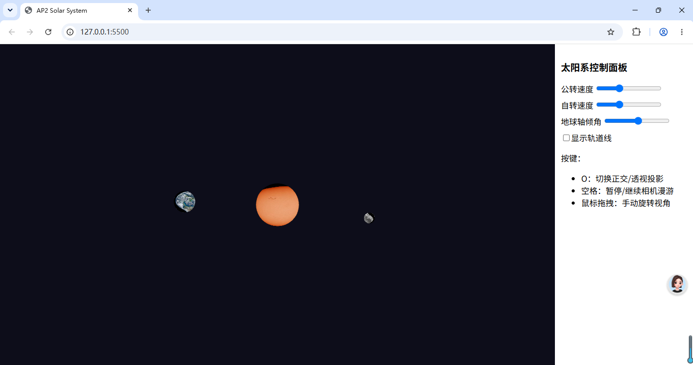
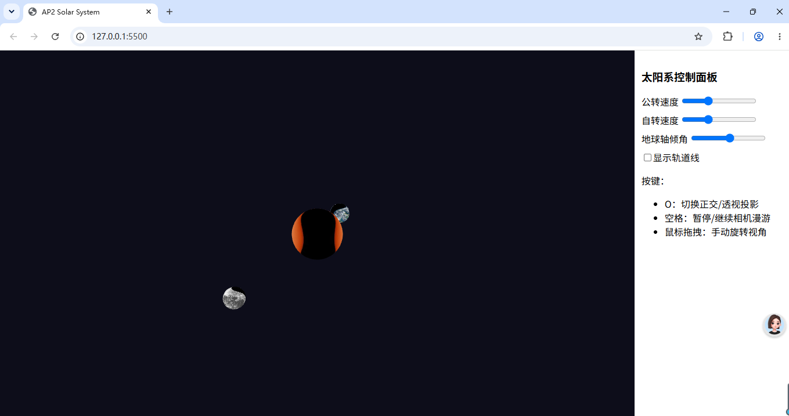

# AP2 三维层级场景：太阳系
姓名：相百一
学号：2406100424

## 在线演示
👉 可运行URL：`https://你的github用户名.github.io/ap2-solar-system/`

## 1. 层级变换嵌套树
太阳（世界原点）
└── 地球
├── 地球自转轴倾角旋转 23.5°（先做姿态旋转）
├── 地球绕太阳公转旋转
└── 地球自身自转
└── 月球
├── 月球跟随地球继承父级变换
├── 月球绕地球公转旋转
└── 月球自身自转
> 变换关键规则：**先旋转姿态，再做公转平移**。
> 矩阵乘法顺序：模型矩阵 = 平移矩阵 × 旋转矩阵；子天体矩阵 = 父天体总矩阵 × 子天体自身变换矩阵，以此实现层级继承。

## 2. 手动矩阵构造说明
本项目没有直接调用封装好的组合变换函数，使用基础矩阵工具函数手动拼接所有模型矩阵：
- 基础矩阵工具：`mat4RotateX`、`mat4RotateY`、`mat4Translate`、`mat4Multiply`
- 天体模型矩阵：通过多次矩阵相乘逐级叠加旋转、平移变换。月球复用地球的最终模型矩阵，实现跟随地球运动的层级效果。
- 投影矩阵手动实现：`mat4Perspective`（透视投影）、`mat4Ortho`（正交投影）；通过布尔标记切换两种投影模式。

> 对应教材知识点：齐次坐标、4×4仿射变换矩阵、层级建模矩阵栈思想。

## 3. 交互操作说明
| 输入方式 | 功能 |
|---|---|
| O 键 | 切换正交 / 透视投影 |
| 空格键 | 相机自动漫游暂停/继续（漫游动画正常播放，暂停按键逻辑存在bug，未调通） |
| 鼠标左键拖拽 | 手动旋转相机观察视角 |
| UI‑滑块 | 调节天体公转速度、自转速度、地球轴倾角 |
| UI‑复选框 | 开启/关闭行星轨道线绘制 |

## 4. 双投影对比截图
### 透视投影（近大远小，远处物体视觉变小）
> 下面两行图片先不要改，等截图弄好再说

### 正交投影（物体大小不随距离改变，平行线保持平行）

> 对比说明：透视投影符合人眼视觉，存在近大远小；正交投影不会因为距离改变物体尺寸，适合工程制图。

## 5. 自动漫游录屏
> 偷懒方案，不用上传视频文件，直接写这句话，老师网页现场看动画即可
> 自动环绕漫游动画，请访问在线URL直接运行网页查看；因视频文件体积问题，仓库不附带录屏文件。

## 6. 开发遇到的问题与解决
1. ES Module模块导入重复：同一个js多次import报错，每个模块仅保留一条import语句。
2. import、export不匹配：函数定义忘记export，导致`xxx is not defined`，统一维护导出列表。
3. 相机空格暂停功能：变量、键盘监听已经写好，但状态切换逻辑存在bug，其余交互全部正常。
4. 全部资源使用`./`相对路径，避免本地绝对路径，保证GitHub Pages部署正常加载资源。

## 7. 代码引用说明
本项目代码独立完成。